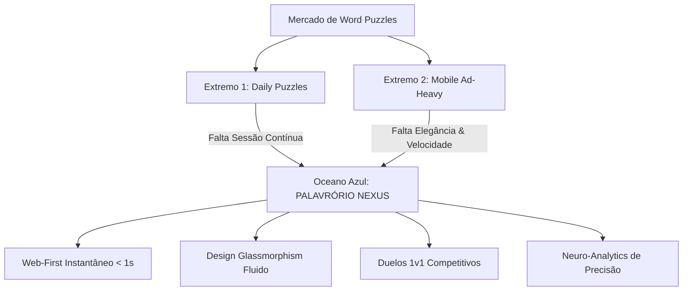
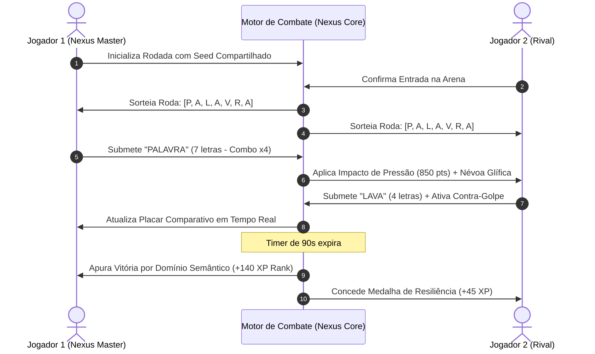

# PRD Estratégico & Documento de Arquitetura Conceitual
# PALAVRÓRIO NEXUS: A Próxima Fronteira dos Jogos Cognitivos de Palavras

**Document ID:** `docs/plans/2026-10-20-planejamento-estrategico-nexus-edition.md`  
**Versão:** 3.0.0-ENTERPRISE / HIGH-FIDELITY VISION  
**Data:** 20 de Outubro de 2026  
**Status:** Aprovado para Prototipação Executiva & Pitch de Inovação  
**Classificação:** Estratégico / Confidencial (Apresentação a Stakeholders & Engenharia)  
**Telas Conceituais Interativas em Código:** `telas-conceito/index.html`

---

## 1. Sumário Executivo & Visão do Produto

### 1.1 Tese de Mercado & Oportunidade
O mercado global de jogos casuais e jogos de agilidade cognitiva (*Brain Training & Word Puzzles*) atingiu um valor estimado de **USD 4.8 bilhões**, impulsionado pela busca por entretenimento produtivo e micro-momentos diários de foco.

Contudo, o cenário contemporâneo encontra-se polarizado em dois extremos deficitários:
1. **O Paradoxo do Desafio Único (Ex: *Wordle / Termo*):** Engajamento explosivo, mas restrito a um único desafio diário, gerando evasão de jogadores que demandam sessões contínuas (*binge-playing*).
2. **A Saturação por Anúncios Agressivos (Ex: *Wordscapes / Letroca mobile*):** Experiências frustrantes com anúncios em vídeo a cada 90 segundos, interfaces abarrotadas, consumo excessivo de bateria e dependência de downloads de 150MB+.

**Palavrório Nexus** surge como a evolução definitiva da experiência de anagramas em língua portuguesa: uma plataforma **Web-First de latência zero**, construída com tecnologias nativas (*Vanilla Web Core*), estética ultra-refinada em **Dark Glassmorphism**, feedback sonoro sintetizado em tempo real (*Web Audio API*) e uma fusão pioneira entre **treino cognitivo de alto nível** e **mecânicas de duelo multijogador competitivo**.



---

## 2. Personas Estratégicas & Jornadas do Usuário

### Persona 1: Drª Gabriela Ramos (34 anos) — "A Buscadora de Foco"
- **Perfil:** Médica neurologista, rotina intensa entre cirurgias e consultório.
- **Motivação:** Busca uma pausa de 10 minutos entre consultas para descompressão mental sem poluição visual ou ruído de anúncios.
- **Jornada no Nexus:** Abre o link instantaneamente no celular; joga o *Modo Arena Solo*; aprecia as transições de som suaves em escala pentatônica; consulta seu *Índice de Agilidade Semântica* no Neuro-Hub ao final do dia.

### Persona 2: Lucas Silveira (22 anos) — "O Competidor Ágil"
- **Perfil:** Estudante de Ciência da Computação, jogador assíduo de eSports e jogos de tabuleiro rápidos.
- **Motivação:** Deseja demonstrar superioridade léxica e velocidade de digitação em disputas contra amigos da faculdade.
- **Jornada no Nexus:** Gera uma sala de *Duelo 1v1* via link direto; utiliza combos de palavras de 6 letras para acionar o efeito de interferência visual no tabuleiro do rival; conquista pontos de ranqueamento para subir na Liga Mestre.

### Persona 3: Roberto de Andrade (59 anos) — "O Mestre Tradicional"
- **Perfil:** Engenheiro aposentado, leitor assíduo e apaixonado por palavras cruzadas clássicas.
- **Motivação:** Manter o vocabulário afiado, descobrir etimologias e desafiar o próprio intelecto sem barreiras de acessibilidade.
- **Jornada no Nexus:** Aproveita os modos de alto contraste WCAG AAA e tipografia otimizada; expande o dicionário de sinônimos com cada palavra descoberta; monitora sua constelação de raízes de palavras dominadas.

---

## 3. Matriz de Requisitos Funcionais (FR)

### FR-01: Roda de Letras Holográfica (Nexus Word Wheel)
- **FR-01.1 (Cálculo Polar Reativo):** Posicionamento harmônico dos nós de letras através de coordenadas trigonométricas puras, com alvos táteis mínimos de **54px** no mobile e suporte a toque multitouch.
- **FR-01.2 (Traçado Elástico Laser):** Conexão visual entre letras ativas renderizada via SVG dinâmico com brilho neon (*drop-shadow blur*), gradiente ciano-magenta e física elástica.
- **FR-01.3 (Entrada Tri-Modal):**
  - *Gesto Polar:* Arrastar fluido entre os nós com retenção háptica simulada.
  - *Toque Discreto:* Seleção por clique sequencial com nó central de disparo.
  - *Teclado Físico (Power-User):* Digitação transparente via `keydown` com mapeamento instantâneo, `Backspace` para retroceder e `Enter` para envio.
- **FR-01.4 (Rotação Quântica / Shuffle):** Reordenação instantânea das letras com animação de torque em 3D sem perda da seleção em andamento.

### FR-02: Matriz Dinâmica de Palavras (Quantum Word Matrix)
- **FR-02.1 (Cards de Vidro Fosco):** Cada palavra do desafio é agrupada por extensão métrica (3 a 8 letras), exibida em cartões de vidro translúcido com relevo tátil.
- **FR-02.2 (Flip 3D & Revelação Estelar):** Ao validar uma palavra correta, execução de animação de rotação com emissão de partículas douradas em CSS puro.
- **FR-02.3 (Cofre de Vocábulos Bônus):** Palavras dicionarizadas válidas em português que não figuram na grade principal são creditadas no *Cofre Bônus*, gerando mana cognitiva e pontos extras de temporada.

### FR-03: Modo Arena Multijogador 1v1 (Mental Clash)
- **FR-03.1 (Sincronização em Tempo Real):** Partidas de 90 segundos onde dois jogadores competem sobre o mesmo pool de letras ou em tabuleiro espelhado.
- **FR-03.2 (Barra de Dano & Estabilidade Mental):** Cada palavra submetida gera um projétil de energia proporcional à complexidade métrica (ex: 3 letras = 150 pts de pressão; 6 letras = 850 pts de impacto e atordoamento de 1 segundo).
- **FR-03.3 (Habilidades Léxicas Especiais / Spells):**
  - *Névoa de Glifos (Custo: 300 Mana):* Oculta duas letras da roda do oponente com fumaça cósmica por 4 segundos.
  - *Onda de Choque Consonantal (Custo: 500 Mana):* Embaralha instantaneamente as letras da roda rival.
  - *Oráculo Cósmico (Custo: 200 Mana):* Revela instantaneamente a maior palavra oculta do tabuleiro.

### FR-04: Neuro-Hub & Gráfico de Competência Cognitiva
- **FR-04.1 (Gráfico Radar Hexagonal SVG):** Renderização vetorial responsiva avaliando 6 pilares cognitivos:
  1. *Velocidade Léxica* (palavras por minuto)
  2. *Memória de Trabalho* (retenção de prefixos e sufixos)
  3. *Reconhecimento de Padrões* (identificação de anagramas raros)
  4. *Resiliência sob Pressão* (desempenho nos últimos 15 segundos)
  5. *Amplitude Semântica* (diversidade de classes gramaticais)
  6. *Precisão Ortográfica* (taxa de erros de submissão)
- **FR-04.2 (Constelação de Palavras):** Mapa visual estelar conectando todas as raízes latinas e gregas já dominadas pelo usuário na sua trajetória.

### FR-05: Sistema de Áudio Procedural Biorreativo
- **FR-05.1 (Síntese Nativa):** Implementação sem arquivos `.mp3/.wav` pesados, utilizando osciladores senoidais e nós de ganho da `Web Audio API`.
- **FR-05.2 (Escala Pentatônica Dinâmica):** A cada letra conectada em sequência, o tom sobe harmonicamente na escala de Fá Maior Pentatônica (F4, G4, A4, C5, D5, F5), gerando sensação imediata de realização e ritmo musical.

---

## 4. Requisitos Não-Funcionais (NFR) & Governança Técnica

| Código | Dimensão | Critério de Aceitação | Mecanismo de Validação |
| :--- | :--- | :--- | :--- |
| **NFR-01** | **Performance de Carga** | FCP (First Contentful Paint) < 400ms em rede 4G simulada. | Lighthouse & Web Vitals nativos |
| **NFR-02** | **Taxa de Quadros** | 60 FPS estáveis em telas 60Hz e 120 FPS em displays ProMotion. | `requestAnimationFrame` audit |
| **NFR-03** | **Zero Bundlers / Zero Bloat** | Aplicação executável diretamente via navegador, sem compilação pesada obrigatória. | Arquitetura ES6+ Modular |
| **NFR-04** | **Acessibilidade WCAG 2.2** | Conformidade nível AAA: contraste mínimo de 7:1 em texto, suporte a leitores de tela `aria-live`. | Axe-Core & Auditoria Manual |
| **NFR-05** | **Persistência Offline Resiliente** | Continuidade do progresso mesmo em perda de conexão via `localStorage` com checksum SHA-256 local. | Simulação Offline Service Worker |

---

## 5. Arquitetura de Sistemas & Diagramas de Engenharia

### 5.1 Diagrama Global de Fluxo e Componentização

```mermaid
flowchart TD
    subgraph Client [Camada do Cliente - Vanilla Web Core]
        UI[Motor de Apresentação Glassmorphism]
        InputController[Controlador Polar de Gestos & Teclado]
        AudioEngine[Sintetizador Procedural Web Audio API]
        StateStore[Gerenciador Reativo de Estado Local]
    end

    subgraph Logic [Núcleo de Inteligência & Validação]
        TrieValidator[Dicionário em Trie/DAWG O(1)]
        ComboEngine[Calculador de Streaks & Multiplicadores]
        NeuroEvaluator[Avaliador de Métricas Cognitivas]
    end

    subgraph Networking [Módulo Conectividade Opcional]
        WebRTC[Canal Peer-to-Peer para Duelo 1v1]
        LeaderboardSync[Sincronizador de Ligas Globais]
    end

    InputController --> UI
    InputController --> AudioEngine
    InputController --> TrieValidator
    TrieValidator --> ComboEngine
    ComboEngine --> StateStore
    ComboEngine --> NeuroEvaluator
    StateStore --> UI
    StateStore --> WebRTC
    WebRTC --> LeaderboardSync
```

### 5.2 Ciclo de Vida de uma Rodada Competitiva 1v1



---

## 6. Especificação das Telas Conceituais em Código

Para materializar o planejamento visual sem recorrer a renderizações artificiais e garantindo acabamento cinematográfico, foi criada a suíte interativa no diretório `telas-conceito/`:

### 6.1 Tela Conceitual 01: Nexus Word Arena (Single-Player Imersivo)
- **Localização no Código:** Aba `01. Nexus Arena` em `telas-conceito/index.html`.
- **Destaques de Design:**
  - Background com 3 camadas de auroras animadas via CSS keyframes.
  - Roda polar interativa com 8 letras, nós de vidro translúcido com reflexo especular e anel orbital de néon.
  - Tabuleiro de palavras em grid CSS flexível com células de revelação dourada.
  - HUD superior com medidor de combo em chamas, contador de palavras bônus em cristais e orbe de dica dimensional.

### 6.2 Tela Conceitual 02: Duelo Mental 1v1 (Arena Competitiva)
- **Localização no Código:** Aba `02. Duelo 1v1` em `telas-conceito/index.html`.
- **Destaques de Design:**
  - Header *Versus* com avatares cibernéticos de alta resolução em CSS, barras de estamina/vida pulsantes e indicador de ping.
  - Campo central de combate léxico com palavras em rota de colisão (*Shared Clash Battlefield*) e feixes de partículas neon.
  - Barra de ações de interferência tática (Névoa, Embaralhar Rival, Oráculo).
  - Timer central com anel circular SVG em contagem decrescente.

### 6.3 Tela Conceitual 03: Neuro-Hub & Galáxia de Conhecimento
- **Localização no Código:** Aba `03. Neuro-Hub` em `telas-conceito/index.html`.
- **Destaques de Design:**
  - Painel de diagnósticos cognitivos com Gráfico de Radar de 6 pontas desenhado em SVG vetorial milimétrico.
  - Mapa de Constelação estelar interativo exibindo grupos etimológicos e estrelas de domínio.
  - Indicadores de KPIs de performance cerebral (Precisão 98.2%, Velocidade 42 WPM, Foco 94%).
  - Trilha de recompensas do Passe de Temporada com progressão de XP e baús de cosméticos.

### 6.4 Tela Conceitual 04: Visualizador Executivo do PRD
- **Localização no Código:** Aba `04. PRD Executivo` em `telas-conceito/index.html`.
- **Destaques de Design:**
  - Painel de leitura corporativa com tipografia refinada, cartões de métricas, metas de sprint e tabela de risco.

---

## 7. Modelo Econômico & Monetização Saudável

Diferente dos concorrentes tradicionais que monetizam via interrupção forçada, Palavrório Nexus adota o **Modelo de Prestígio e Valor Agregado**:

1. **Acesso Gratuito Irrestrito (Zero Paywall de Jogabilidade):**
   - O jogo básico e todos os modos ilimitados são 100% gratuitos e livres de anúncios interruptivos.
2. **Passe de Temporada "Expedição Cósmica" (R$ 14,90 / trimestre):**
   - Desbloqueio de temas visuais exclusivos de vidro (Ex: *Vidro Obsidiana Vulcânica*, *Neve Nórdica*, *Cristal Quartzo Rosa*).
   - Pacotes de áudio procedural sintetizado (Ex: *Sinfônico Barroco*, *Synthwave 80s*, *Templo Zen*).
3. **Licenciamento Educacional & Corporativo (Nexus for Teams):**
   - Módulo adaptado para treinamento de agilidade mental em empresas, escolas e clínicas de reabilitação neurocognitiva com dashboards agregados de equipe.

---

## 8. Matriz de Priorização (RICE) & Roadmap de Desenvolvimento

| Iniciativa | Reach (Alcance) | Impact (Impacto) | Confidence (Confiança) | Effort (Esforço) | RICE Score | Prioridade |
| :--- | :---: | :---: | :---: | :---: | :---: | :---: |
| **Roda Polar Híbrida & Traçado Laser** | 100% | 3.0 (Massivo) | 95% | 2 semanas | **1425** | **P0 (Imediata)** |
| **Sintetizador Web Audio Procedural** | 100% | 2.5 (Alto) | 90% | 1 semana | **2250** | **P0 (Imediata)** |
| **Duelo 1v1 via WebRTC Peer-to-Peer** | 70% | 3.0 (Massivo) | 85% | 3 semanas | **595** | **P1 (Sprint 2)** |
| **Neuro-Hub de Métricas Cognitivas** | 80% | 2.0 (Médio) | 90% | 2 semanas | **720** | **P1 (Sprint 2)** |
| **Modo Liga e Passe de Temporada** | 60% | 2.5 (Alto) | 80% | 4 semanas | **300** | **P2 (Sprint 3)** |

---

## 9. Próximos Passos & Validação

- [x] Conclusão da Especificação Executiva do PRD (`docs/plans/2026-10-20-planejamento-estrategico-nexus-edition.md`).
- [x] Eliminação da documentação anterior em favor de artefatos integrados de alta fidelidade.
- [x] Construção das telas conceituais interativas em HTML5, CSS Glassmorphism e JavaScript modular em `telas-conceito/`.
- [ ] Validação tátil dos protótipos em dispositivos móveis (360px a 430px) e monitores Ultrawide.
- [ ] Sessão de demonstração para banca executiva e investidores de inovação.
